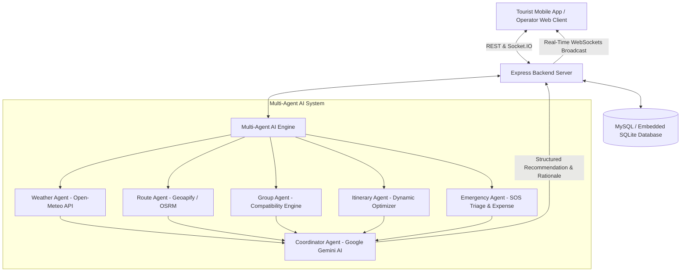

# 🌍 TrailSync - Intelligent Tourism Management Platform

A production-grade, full-stack intelligent tourism management platform designed for **Tour Operators** and **Tourists**. The platform features **Multi-Agent AI Coordination**, **Adaptive Micro-Grouping**, **Real-time GPS Tracking on Live Maps**, **Dynamic Weather-Aware Itinerary Replanning**, **Multilingual Voice Assistance (6 Indian Languages)**, **Emergency SOS Coordination & Triage**, and **Tour & Emergency Reserve Cost Estimators**.

---

## 🚀 Live Deployed Platform
- 🖥️ **Operator Command Center**: [https://intelligent-tourism-platform-eight.vercel.app/operator](https://intelligent-tourism-platform-eight.vercel.app/operator)
- 🧳 **Tourist Mobile Experience**: [https://intelligent-tourism-platform-eight.vercel.app/tourist](https://intelligent-tourism-platform-eight.vercel.app/tourist)
- 🔑 **Instant Demo Login**: [https://intelligent-tourism-platform-eight.vercel.app/login](https://intelligent-tourism-platform-eight.vercel.app/login) *(Features 1-click fast login presets for both Operator and Tourists)*

---

## 📸 Core Capabilities

1. **Tour Operator Command Center**:
   - Modern glassmorphic SaaS dashboard with live environmental telemetry, KPI cards, and notification center.
   - Comprehensive Tour & Tourist Management with preference profiles (walking pace, language, accessibility, dietary, emergency contacts).
   - **Adaptive Grouping Engine**: Dynamic clustering of tourists into micro-groups (Alpha, Beta, Gamma) using compatibility scoring (walking pace, activity style, language, age, and accessibility).
   - **Live Interactive Map**: Powered by React-Leaflet with real-time GPS telemetry, color-coded group avatars, destination waypoints, and pulsing SOS markers.
   - **Dynamic Itinerary**: Interactive timeline with automated weather-proof activity substitution.
   - **Multi-Agent AI Intelligence**: Real-time telemetry consensus across 5 sub-agents and Google Gemini Coordinator Agent.
   - **Emergency SOS Command Center**: Real-time incident queue, nearest ranger/medical post dispatch locator (~6 min ETA), and emergency expense estimation.
   - **Tour & Emergency Cost Estimator**: Pre-booking budget calculator and operational reserve impact modeler.
   - **Analytics Dashboard**: Recharts demographic distributions, group compatibility gauges, and expense allocations.

2. **Tourist Mobile App Interface**:
   - Mobile-first responsive app shell with live tour status, group lead contact, and next activity countdown.
   - **Multilingual Voice Assistant**: Powered by Web Speech API (Speech Recognition & Synthesis) with support for **English, Tamil (தமிழ்), Hindi (हिन्दी), Malayalam (മലയാളം), Telugu (తెలుగు), and Kannada (ಕನ್ನಡ)** answering tour-specific questions in real time.
   - **High-Visibility Emergency SOS**: One-tap emergency broadcast transmitting precise GPS coordinates to the operator dashboard and local responders.
   - **Live Group Map**: Mobile view of fellow group members and destination landmarks.

3. **Interactive Demo Simulation Mode**:
   - Built-in simulation controller walking through the full 18-step end-to-end scenario.
   - Automated tourist GPS walking stream along Nilgiri botanical trails.
   - One-click triggers for sudden rain disruptions and emergency SOS incidents.

---

## 🏛️ Architecture & Multi-Agent System



---

## 🛠️ Technology Stack

| Layer | Technologies |
| :--- | :--- |
| **Frontend** | React 18, Vite, Tailwind CSS v4, React Router v7, React-Leaflet, Leaflet, Socket.IO Client, Recharts, Lucide Icons, Canvas Confetti, Web Speech API |
| **Backend** | Node.js, Express.js, Socket.IO, JWT Authentication, Bcrypt.js, RESTful Architecture |
| **Database** | MySQL (with zero-config embedded SQLite auto-fallback for immediate evaluation), Full Relational Schema & Seed Data |
| **AI / Multi-Agent** | Google Gemini 2.5 Flash, Open-Meteo Weather API, Geoapify Routing API, Rule-based Clustering Engine |
| **Languages** | English, Tamil, Hindi, Malayalam, Telugu, Kannada |

---

## 📂 Project Structure

```text
intelligent-tourism-platform/
├── backend/
│   ├── config/
│   │   └── db.js                 # Unified MySQL/SQLite DB adapter with auto-seed
│   ├── agents/
│   │   ├── WeatherAgent.js       # Open-Meteo & weather risk engine
│   │   ├── RouteAgent.js         # Geoapify & route feasibility engine
│   │   ├── GroupAgent.js         # Multi-dimensional compatibility clustering
│   │   ├── ItineraryAgent.js     # Weather-aware timeline adapter
│   │   ├── EmergencyAgent.js     # SOS triage & expense range estimator
│   │   └── CoordinatorAgent.js   # Gemini synthesis & consensus engine
│   ├── controllers/              # REST & AI Controller modules
│   ├── routes/                   # Express route definitions
│   ├── middleware/
│   │   └── auth.js               # JWT & Role authorization
│   ├── sockets/
│   │   └── socketHandler.js      # Real-time WebSocket event broadcaster
│   ├── server.js                 # Express server entry point
│   └── package.json
│
├── frontend/
│   ├── src/
│   │   ├── components/           # UI components
│   │   ├── context/
│   │   │   ├── AuthContext.jsx       # Auth state & demo role switching
│   │   │   ├── SocketContext.jsx     # Live WebSocket events & alert toasts
│   │   │   └── SimulationContext.jsx # 18-step scenario runner & GPS stream
│   │   ├── layouts/
│   │   │   ├── OperatorLayout.jsx    # SaaS Operator Dashboard shell
│   │   │   └── TouristLayout.jsx     # Mobile Tourist App shell
│   │   ├── pages/
│   │   │   ├── auth/                 # Login & Register
│   │   │   ├── operator/             # 8 Operator management pages
│   │   │   └── tourist/              # 4 Tourist app pages
│   │   ├── services/
│   │   │   └── api.js                # Axios API client
│   │   ├── App.jsx                   # Router & application entry
│   │   └── index.css                 # Glassmorphism, Leaflet & Tailwind styles
│   ├── vite.config.js
│   └── package.json
│
├── database/
│   ├── schema.sql                # Complete 20-table MySQL relational schema
│   ├── seed.sql                  # Realistic demo data (Nilgiris Tour)
│   └── intelligent_tourism.sqlite # Auto-generated zero-config SQLite db
│
├── .env.example
├── README.md
└── package.json
```

---

## 🚀 Quick Start Guide

### 1. Prerequisites
- **Node.js** (v18 or higher)
- **NPM** (v9 or higher)
- *(Optional)* MySQL Server (If MySQL is not running, the application will automatically initialize the embedded SQLite database).

### 2. Installation
Clone the repository and install dependencies:

```bash
# Install backend dependencies
cd backend
npm install

# Install frontend dependencies
cd ../frontend
npm install

# Install root dependencies
cd ..
npm install
```

### 3. Environment Configuration
Create `.env` inside `backend/`:

```env
PORT=5000
NODE_ENV=development
JWT_SECRET=tourism_intelligent_platform_jwt_secret_key_2026_super_secure

# Optional: Add your Google Gemini or Geoapify API keys
GEMINI_API_KEY=
GEOAPIFY_API_KEY=

# Optional: MySQL Credentials (leave blank to use zero-config SQLite)
DB_HOST=
DB_USER=
DB_PASSWORD=
DB_NAME=intelligent_tourism_db
```

### 4. Running the Application

To run both backend and frontend concurrently with a single command:

```bash
npm run dev
```

Or run them individually in separate terminals:

```bash
# Terminal 1 - Backend Server (Port 5000)
npm run dev:backend

# Terminal 2 - Frontend Application (Port 5173)
npm run dev:frontend
```

Open your browser and navigate to: **`http://localhost:5173`**

---

## 🔑 Demo Credentials

| Role | Email | Password | Access Level |
| :--- | :--- | :--- | :--- |
| **Tour Operator** | `operator@tourism.com` | `Password123!` | Full Operator Command Center |
| **Tourist** | `rahul.kumar@gmail.com` | `Password123!` | Tourist Mobile Guide (Group Alpha) |

> 💡 **Tip**: The login page includes **1-Click Demo Buttons** for both roles to allow instant access without typing credentials. You can also switch roles at any time using the role switch button in the navigation bar.

---

## 🔄 End-to-End Demo Workflow Scenario

The application includes an interactive **18-Step Scenario Guide** visible at the top of the Operator layout:

1. **Operator views tour**: Nilgiris Grand Heritage & Botanical Discovery tour loaded with destinations and budget.
2. **Tourists Analyzed**: 16 tourists with diverse walking preferences, accessibility needs, and languages.
3. **AI Adaptive Grouping**: Group Agent forms 3 micro-groups (Alpha: Trekkers, Beta: Heritage, Gamma: Leisure) with compatibility gauges (96%, 91%, 88%).
4. **Operator Approves Groups**: One-click approval updates database and triggers confetti celebration.
5. **Live Map Tracking**: Tourists stream real-time GPS coordinates to Leaflet map.
6. **Weather Change Simulated**: Click **"Simulate Rain Spike"** in top bar.
7. **Multi-Agent Consensus**: Weather Agent flags 75% rain, Route Agent notes ghat road delays, Itinerary Agent finds indoor fallback (Tea Museum & Chocolate Studio), and Coordinator Agent (Gemini) generates recommendation with full rationale.
8. **Operator Approves Reroute**: One-click approval updates the live itinerary across all screens in real time.
9. **Tourist Voice Assistant**: Tourist asks *"What is my next activity?"* in Tamil/Hindi/English and receives the updated indoor activity.
10. **Emergency SOS Triggered**: Click **"Simulate SOS"** or trigger SOS from tourist screen.
11. **Instant Emergency Broadcast**: Live map automatically focuses on the tourist, alerts the operator, triages closest ranger post (~6 min ETA), and calculates operational expense range (₹1,500 – ₹3,000 against ₹25,000 reserve).
12. **Operator Resolves Incident**: Operator assigns responder, enters medical notes, and marks emergency resolved.

---

## 🛡️ Security & Reliability Features

- **JWT Authentication & Role-Based Guarding**: Strictly enforces operator vs tourist privileges.
- **Fail-Safe Multi-Agent System**: If external APIs (Gemini, Open-Meteo, Geoapify) are offline or keys are unset, high-fidelity heuristic engines maintain 100% platform functionality.
- **Zero-Config Database**: Seamlessly switches between MySQL in production and embedded SQLite in local development.
- **Emergency Priority Isolation**: Emergency SOS messages bypass non-critical queues and broadcast with maximum priority.
